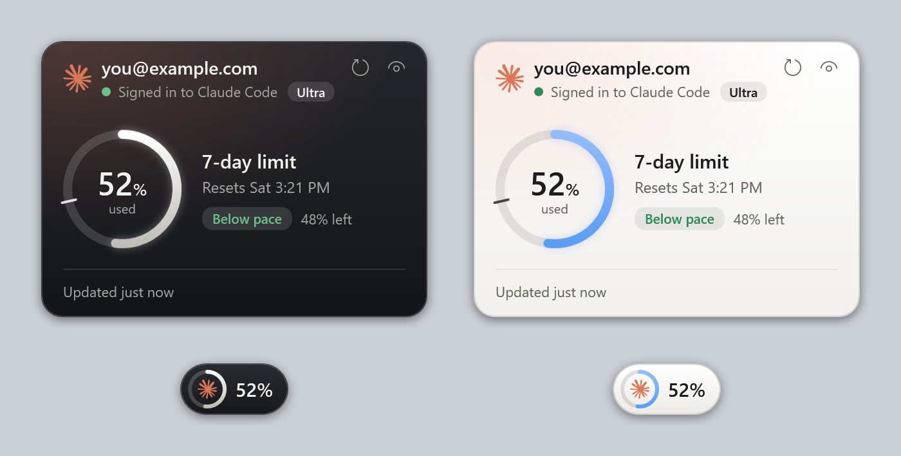

# Claude Account Widget

A small Windows desktop widget that shows which account Claude Code is signed in to and how much of your plan's usage limit you've used.



> **Unofficial project.** This isn't affiliated with or endorsed by Anthropic. Claude and the Claude logo are Anthropic's trademarks.

This is an early pre-release, so expect some rough edges.

## Features

- **Account:** shows the signed-in email and plan name, with an optional warning if the wrong account is signed in.
- **Usage:** shows a 7-day ring with the percentage used and reset time. A 5-hour bar appears only when a 5-hour figure is reported.
- **Pace:** shows how your usage compares with the time passed in the 7-day window.
- **Small icon:** minimizes to a pill that keeps the percentage visible.
- **Appearance:** follows the Windows light or dark theme, with six ring colors.
- **App icon:** shows the Claude spark in the taskbar and on the app file.
- **Alert colors:** turns amber at 70% and red at 90%, whichever ring color you choose.
- **New chat:** opens chat windows that use your Claude Code sign-in, save to a folder you choose and can look back at earlier saved chats.

## Requirements

- Windows 10 or 11, with .NET Framework 4.6 or later (included with Windows)
- Claude Code, signed in with a Claude subscription
- Node.js, only for the optional status line

## Install

### Download

1. Get `ClaudeAccountWidget.exe` from the [latest release](https://github.com/Sh0aib-Ja0allah/claude-account-widget/releases).
2. Put it in its own folder, because the widget saves its files next to the app.
3. Run it.

The file isn't digitally signed, so Windows SmartScreen or your antivirus may warn you. The release notes list its SHA-256 hash if you want to check your download.

### Build from source

Building lets you review the code first, and it also installs the optional status line script. Download the source, then run this from the repo folder:

```powershell
powershell -ExecutionPolicy Bypass -File .\build.ps1
```

This compiles the widget with the C# compiler included in Windows and installs it to `%LOCALAPPDATA%\ClaudeAccountWidget`. Start it with:

```powershell
& "$env:LOCALAPPDATA\ClaudeAccountWidget\ClaudeAccountWidget.exe"
```

## Using it

| To do this | Do this |
|---|---|
| Move it | Drag the widget or the small icon |
| Minimize it | Click the eye icon |
| Reopen it | Click the small icon |
| Start a chat | Click the chat icon in the footer. Each click opens a new window |
| Check usage now | Click the refresh icon (at most once every 30 seconds) |
| See more options | Right-click for Always on top, Start with Windows, Ring color, Refresh now and Exit |

Always on top starts on, and Start with Windows starts off.

### New chat windows

Press Enter to send and Shift+Enter for a new line. While Claude is working, the send button becomes Stop, and Esc does the same. To minimize a chat, click the **-** icon. To fill the screen, click the extend icon next to the close button or double-click the header. Click it again or press Esc to go back.

**Chat history:** in full screen, a sidebar lists your saved chats under **Recents**, newest first. Click a chat to continue it, or click **New chat** to start fresh. To rename the open chat, click its name at the top and choose **Rename**. To delete a chat, choose **Delete** there, or hover over it in the list and click the trash icon, then confirm. Its note moves to the Windows Recycle Bin, and Claude can no longer recall it. The menu icon hides the sidebar, and another appears beside the chat title to bring it back. A reopened chat keeps its messages, but attached files show as no longer attached, so add them again to keep working on them. Replies are plain text that you can select or copy. By default, Claude can only read your chat history folder and what you attach. It can't run commands or change files unless you turn on laptop access.

**Attachments:** click **+** and choose **Files and images** or **Folder**, drag them onto the window, or press Ctrl+V to paste a screenshot.

| Add this | What happens |
|---|---|
| Images (PNG, JPG, GIF, WebP) | Sent with your message. Large ones are made smaller first |
| PDFs and text or code files | Sent with your message |
| Other file types, and text files that are too long | Only work with laptop access, where Claude gets the file's path and opens it itself, at any size |
| A folder | Claude can read that folder for the rest of this chat. Its files aren't copied or sent until Claude reads them |
| A link | Type or paste it in your message. Claude can open it and other pages on that site. Any other site asks you first |

A chat can send 20 MB of files. Everything sent in a window goes again with each message so Claude can keep using it, which uses more of your plan.

Attachments stay in that window while it's open and are never copied to your chat history folder. Its note lists only their names, so other chats and later windows can't see what was in them. Attach them again to keep working on them.

**Files Claude makes:** with laptop access on, ask Claude to create a file and a card appears in the chat, showing the file's first page or opening lines. Click it to preview it. Files stay in the output folder, and a chat's note records only where they are. Claude can make Word and similar files only with a command you approve and the tools on your computer, such as Python.

**The preview:** in full screen a file opens beside the chat. Otherwise it opens in its own window. What you see depends on the file:

- **PDF, Word, PowerPoint and Excel** show as real pages, with thumbnails, page controls and zoom. Use the arrow keys to move between slides, and the tabs to move between sheets. Word, PowerPoint and Excel pages are drawn by LibreOffice, so they can differ slightly from Microsoft Office. Without LibreOffice, the file's own Windows preview component is used if it has one, in a separate window and without these controls.
- **Markdown, HTML, SVG and CSV** show formatted, with a Preview/Code switch. Web pages are drawn by Microsoft Edge from a copy that forbids scripts and has no network, so nothing in them runs.
- **Code and text** show with colored syntax. **Pictures** zoom with the mouse wheel and drag around.

Press Ctrl+F to search. Select words to copy them or send them to the chat with Ask Claude. On pages and pictures of text, Windows text recognition reads the words, so a word can occasionally be misread, and a page mixing two scripts is read in its main one. The buttons at the top copy, save, print or open the file, and arrows move between the chat's files.

The preview updates when the file changes. Each change is kept as a version you can view or compare, in a `file-versions` folder next to the app, never in your chat history folder. It keeps the last 20 versions of each file, for files up to 50 MB. Converted pages and thumbnails stay in a temp folder so files reopen quickly, and are removed after two weeks or when they pass 500 MB.

**Model and effort:** under the message box, pick a model from the menu. To set the effort, click the effort button and then a dot, from Low on the left to Max on the right. The current dot matches the widget's ring color. Each model option always uses that model's latest version. The menu shows the newest version number the widget has seen, so a new version's number appears after your first reply from it. Chats start on Opus with Medium effort. A change applies from your next message, and new windows start with your last choice. Higher effort and larger models use more of your plan.

Each window sends its whole conversation with every message. To remember other chats, Claude can search and read the notes in your chat history folder, so:

- A chat can be recalled once its exchange has finished and saved, including from windows that are already open and after a restart.
- Recall relies on a search, so Claude can occasionally miss something.
- Without a chat history folder, nothing is saved and Claude can't recall other windows.
- To make Claude forget a chat, close its window and delete its note.

A window stops accepting messages at about 300,000 characters. Open a new chat to continue, which can still find the old one in its note.

### What pace means

The tick on the ring marks how much of the 7-day window has passed. The label compares that with your usage:

| Label | Meaning |
|---|---|
| **Below pace** | Your usage is more than 5 points behind the time passed |
| **On pace** | Your usage is within 5 points of the time passed |
| **Above pace** | Your usage is more than 5 points ahead of the time passed |

The widget assumes the window started exactly 7 days before it resets.

## Optional settings

These settings use the folder where the widget is installed.

**Wrong-account warning:** create `expected-account.txt` containing only the email you expect, then restart the widget. It shows a warning if a different account is signed in. Without this file, it doesn't warn about any account.

**Chat history folder:** create `chat-history-folder.txt` containing only the full path of a folder, such as a folder in your Obsidian vault. Each chat window saves one Markdown note there, in a subfolder for each month. Use a folder just for these chats, because Claude can read everything in it. Without this file, chats aren't saved. New windows pick up a change to this file.

**Folders every chat can read:** create `chat-read-folders.txt` with one full folder path per line, such as your Obsidian vault. Every new chat window can search and read them and is told to look there when you ask about your notes. Whatever Claude reads goes to Anthropic. This doesn't let Claude change those folders. Without laptop access it can't edit anything, and with it, each edit still needs your approval.

**Laptop access for chats:** create `chat-access.txt` containing only `laptop`. New chat windows can then:

- Read files on your fixed drives, without asking. What Claude reads goes to Anthropic.
- Create and edit files in its output folder, without asking. The first time, it makes a `Claude` folder on your desktop with the Claude icon. If that folder already exists, the chat asks whether to use it or a new one, and saves your choice in `chat-output-folder.txt`.
- Search the web, without asking. Search words leave your computer. It asks before opening any site you didn't link.
- Edit or create files and run commands, including deleting, only after you click **Allow** on a card showing what it wants to do.

Read a card before you allow it, because a command can do anything your Windows account can do. Claude is told not to touch your Claude Code sign-in and is blocked from opening the sign-in files directly, but an allowed command could get around that.

**Status line:** this shows usage in the Claude Code terminal footer. It needs Node.js and `statusline.js`, which the source build installs. Add this to `~/.claude/settings.json`, using your own Windows username:

```json
{
  "statusLine": {
    "type": "command",
    "command": "node C:/Users/YOUR_USERNAME/AppData/Local/ClaudeAccountWidget/statusline.js"
  }
}
```

## What it reads and sends

| Item | Use |
|---|---|
| `~/.claude.json` | Reads the signed-in email and plan name |
| `~/.claude/.credentials.json` | Reads the plan name and your Claude login token, without changing the file |
| `https://api.anthropic.com/api/oauth/usage` | Receives the token every 5 minutes to get your usage |
| `claude -p` | Runs once for each chat message, using your Claude Code sign-in |
| Your chat history folder | Claude can search and read its notes, and the widget writes one note for each chat |
| Your files and web search | Only with laptop access on. See [Optional settings](#optional-settings) |

The widget only sends the token to that Anthropic address. It doesn't save it anywhere else or renew it. The `claude` command it starts for chats handles its own sign-in, and may renew it as Claude Code normally does.

The widget saves its usage figures, your email and its settings in its install folder.

**Chat privacy:**

- Anthropic receives each message and its context, including attachments and any saved chat text or file Claude reads to answer. Replies count toward your plan's usage.
- Chats run through `claude -p` with session saving, Remote Control, hooks, plugins and MCP servers off, so the note in your folder is the only saved copy on your computer. Remote Control is what would otherwise show a local session on claude.ai.
- Notes are plain, unencrypted files. Anyone who can open that folder can read them, including through a sync service or a shared vault.
- Without laptop access, Claude's file access is limited to the chat history folder, with read-only tools. Text in notes, files and search results is treated as information, not instructions, but that relies on Claude following its instructions.

## Troubleshooting

| What you see | What it means |
|---|---|
| Waiting for Claude Code to renew its login. | The login token has expired or was rejected. Checks resume after Claude Code renews it, which may need a Claude Code session. |
| Usage checks are paused for a while. | Anthropic asked the widget to slow down. Checks restart automatically. |
| Couldn't check usage. | The check failed, so the widget keeps the last figures and tries again later. |
| No 5-hour row | No 5-hour figure was reported for your account. |
| Not being saved. Can't recall other chats. | `chat-history-folder.txt` is missing or its folder can't be used. |
| Couldn't save the last reply. | The note couldn't be written, so check the folder. The chat keeps working, and the next reply tries again. |
| Claude Code wasn't found. | `claude` isn't on your PATH. |
| Claude Code isn't signed in. | Sign in to Claude Code in a terminal, then try again. |

## Limitations

- **Undocumented usage address:** Anthropic doesn't document this address, so it could change or stop working without warning. The widget would then show a warning and keep the last figures. Review the code and decide whether you're comfortable with this before using it.
- **Windows only:** it's built with WPF.

## Uninstall

1. Right-click the widget, turn off **Start with Windows** if it's on, and choose **Exit**.
2. Delete the widget's folder. For a source build, that's `%LOCALAPPDATA%\ClaudeAccountWidget`.
3. Remove the `statusLine` setting if you added it.

## License

Released under the [MIT License](LICENSE). Copyright © 2026 Shoaib Jadallah.

You can use, change and share this software, including commercially, as long as you keep the copyright and license notice. It comes with no warranty.

The license covers this project's own code. It doesn't grant any rights to Anthropic's trademarks, including the Claude name and logo.
